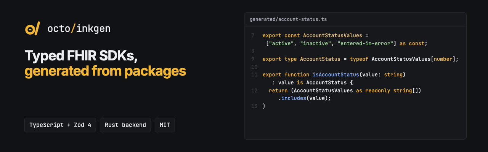
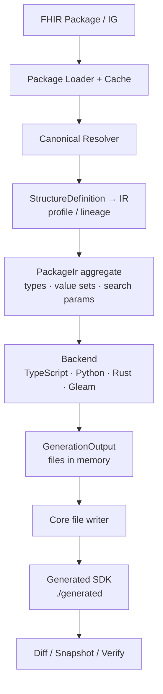

<p align="center"></p>

<p align="center"><b>A Rust FHIR code generator for deterministic, inspectable SDKs — TypeScript, Python, Rust and Gleam — built from FHIR packages, profiles and implementation guides.</b></p>

<p align="center">
  <a href="https://github.com/octofhir/inkgen/actions/workflows/ci.yml"></a>
  <a href="#license"></a>
</p>

InkGen turns canonical FHIR packages into type-safe, idiomatic code. Core
resolves a FHIR package once into a language-neutral `PackageIr`; each backend is
a small pure function of it. The TypeScript backend is full-featured today, a
Python backend emits Pydantic v2 models with runtime validation, and reference
Rust and Gleam backends prove the contract — new backends add a language without
re-implementing FHIR semantics.

> **Status:** active development. The TypeScript backend works and is tested; the
> Python backend generates Pydantic v2 models that typecheck (pyright) and pass
> runtime smoke tests over R4; reference Rust and Gleam backends ship. APIs may
> change. Early adopters and contributors welcome.

---

## Why InkGen?

- **FHIR-aware IR** — a serializable intermediate representation models slicing,
  bindings, extensions, invariants, `value[x]`, cardinality, fixed/pattern
  values, and `mustSupport`, so backends consume structure instead of re-parsing
  raw FHIR.
- **Deterministic output** — ordered with `IndexMap` and explicit sorting so
  regenerating the same input yields the same files (readable diffs).
- **Inspectable** — generated output can be diffed and snapshot-tested; an
  `explain` trace and a generation `report` ship today.
- **Single source of truth** — core resolves a `PackageIr` once (types, type
  metadata, value sets, search parameters); backends read only from it.
- **Tiny backend contract** — one synchronous `Backend` trait
  (`&PackageIr → GenerationOutput`, no I/O, no async, no FHIR resolution). The
  TypeScript, Python, Rust and Gleam backends all implement it.
- **Rust performance** — fast, single-binary CLI (`inkgen`).

Each claim above maps to code in `crates/`; capabilities that are not yet
implemented are listed as **Planned** in the matrix below.

---

## What works today (and what doesn't)

| Capability | Status | Notes |
|---|---|---|
| FHIR package loading & caching | ✅ Implemented | via `octofhir-canonical-manager` |
| Canonical URL resolution | ✅ Implemented | `inkgen-core` services |
| StructureDefinition → IR | ✅ Implemented | `inkgen-core/src/ir` |
| TypeScript interfaces | ✅ Implemented | incl. nested / BackboneElement types |
| TypeScript classes / builders | ✅ Implemented | `interface`, `class`, `class_with_builder` |
| ValueSet generation | ✅ Implemented | closed unions (required/extensible), open unions (preferred/example) |
| `value[x]` choice types | ✅ Implemented | wire-faithful typed members (`valueQuantity`, `valueDateTime`, …); language-neutral lowering in `inkgen-core`; each variant individually optional; `parse*` enforces at most one variant present (exactly one when the choice is required) |
| Profile classes | ✅ Implemented | extension accessors, serialization, validation |
| Zod schemas | ✅ Implemented | Zod 4 idioms (`z.iso.date()`, `z.intersection()` for profiles) |
| Branded primitives | ✅ Implemented | opt-in compile-time safety |
| Primitive extensions (`_field`) | ✅ Implemented | `_x` siblings on interfaces/classes + Zod (`Element`); `is_primitive` decided in `inkgen-core`; `utils/primitive-extensions.ts` alignment helpers + `data-absent-reason` accessor |
| Interop helpers | ✅ Implemented | typed references, date helpers, bundle traversal, search |
| Template overlays | ✅ Implemented | customize templates without forking |
| Directory diff tooling | ✅ Implemented | `inkgen diff` |
| Snapshot tests + benchmarks | ✅ Implemented | `insta`, Criterion (`just bench`) |
| Profile generation (snapshot-based) | ⚠️ Partial | relies on packaged snapshots; differential-only merge is roadmap |
| Generated TypeScript typechecks in CI | ✅ Implemented | `tsc --noEmit` gate over generated r4-core (incl. profiles) |
| Slicing / discriminators | ⚠️ Partial | modeled in IR; TS emits typed accessors for value/pattern-discriminated array slices (e.g. blood-pressure `component`); nested/`exists`/`type` coverage evolving |
| `PackageIr` single source of truth | ✅ Implemented | resolved once in core; backends make zero provider/resolver calls |
| `Backend` contract (`&PackageIr → GenerationOutput`) | ✅ Implemented | sync, no I/O; core writes files |
| Reference Rust backend | ✅ Implemented | `inkgen generate rust` emits compiling structs from the IR alone |
| Gleam backend | ✅ Implemented | `inkgen generate gleam` emits record types from the IR alone |
| Python Pydantic v2 models | ✅ Implemented | `inkgen generate python`; snake_case fields aliased to FHIR wire names, `extra="forbid"`, wire-faithful JSON serialization |
| Python ValueSet enums | ✅ Implemented | closed `Literal` aliases for required/extensible bindings |
| Python runtime validation | ✅ Implemented | `model_validator` checks for `value[x]` choice groups and XOR-exists invariants (e.g. `ext-1`); cross-module cycles resolved via `model_rebuild()` |
| Generated Python typechecks in CI | ✅ Implemented | `pyright` gate + Pydantic runtime smoke tests over generated r4-core |
| `inspect ir` / `explain` / report | ✅ Implemented | IR-as-JSON; `explain` shows why each field maps as it does; `--report` writes report.md + file map |
| C# / other backends | 🗺️ Planned | — |
| WASM plugins | 🗺️ Planned | RFC stage |

---

## Architecture



Core resolves every package input **once** into a `PackageIr` and hands a
`&PackageIr` to the backend. A backend is a pure function — it reads the IR and
returns a `GenerationOutput` (files in memory); core owns writing. No backend
calls the provider or canonical resolver.

---

## Install

```bash
# From a clone (installs the `inkgen` binary):
cargo install --path crates/inkgen-cli

# Verify your environment:
inkgen doctor
```

Prerequisites: Rust stable (edition 2024). [`just`](https://github.com/casey/just)
is optional, for the development recipes below.

---

## Quick start

```bash
inkgen config init                 # create inkgen.toml (use --force to overwrite)
inkgen fetch                       # download configured FHIR packages
inkgen generate typescript         # emit TypeScript into ./generated
```

`inkgen.toml` (created by `config init`) declares packages and TypeScript
options. The default package is `hl7.fhir.r4.core`. All TypeScript features
(profiles, ValueSets, guards, Zod, interop) are enabled by default; opt out per
option.

```toml
[[packages]]
name = "hl7.fhir.r4.core"
version = "4.0.1"

[languages.typescript]
mode = "interface"                 # interface | class | class_with_builder
naming_convention = "pascal"       # pascal | camel | snake
output_structure = "flat"          # flat | by_package
# output_dir = "generated"         # default: ./generated
branded_primitives = true
# structural_guards = false
# generate_profiles = false
# generate_valuesets = false
# validation_schemas = false
# validation_library = "valibot"   # "zod" (default) or "valibot"
```

### Generate options

```
inkgen generate typescript [--output <dir>] [--offline] [--dry-run] [--config <path>] [--package <name>]
```

- `--output <dir>` — override the output directory (default `./generated`)
- `--offline` — require all packages to be pre-cached (no network)
- `--dry-run` — show what would be generated without writing files
- `--package <name>` — restrict to a subset of configured packages

### Python (Pydantic v2)

```bash
inkgen generate python             # emit a Python package into ./generated/python
```

The output is an importable `fhir` package: one module per resource/complex type,
composite classes for backbone elements, `Literal` aliases for enumerated ValueSet
bindings (`enums.py`), and a shared `_runtime.py` base. Fields use `snake_case`
attribute names aliased to FHIR wire names, so both `patient.birth_date` and
`Patient(birthDate=...)` work; models serialize with wire aliases by default,
omit absent (`None`) fields for FHIR-conformant JSON, and reject unknown fields
(`extra="forbid"`). `value[x]` choice groups and XOR-exists
invariants (e.g. `ext-1`) are enforced at runtime by `model_validator`, and
cross-module cycles are resolved with `model_rebuild()` in `__init__.py`.

```python
from fhir import Patient

patient = Patient(gender="female", active=True)
patient.model_dump_json()           # {"resourceType":"Patient","active":true,"gender":"female"}
Patient(gender="not-a-code")        # raises pydantic.ValidationError
```

The generated code requires **Python >= 3.11** and **`pydantic >= 2.11, < 3`** —
dependencies of the output, not of the generator. CI typechecks the generated R4
package with `pyright` and runs runtime smoke tests.

Configure the backend in `inkgen.toml`. `package_name` sets the importable
package directory (default `fhir`); it must be a valid Python identifier:

```toml
[languages.python]
package_name = "fhir_r4"           # import as `from fhir_r4 import Patient`
# output_dir = "generated/python"  # default: ./generated/python
```

```
inkgen generate python [--output <dir>] [--offline] [--dry-run] [--config <path>] [--package <name>]
```

---

## CLI commands

| Command | Purpose |
|---|---|
| `inkgen config init` | create a starter `inkgen.toml` (`--force` to overwrite) |
| `inkgen config validate` | validate the manifest |
| `inkgen config completions <shell>` | emit shell completion scripts |
| `inkgen fetch` | download & cache configured FHIR packages |
| `inkgen generate typescript` | generate the TypeScript SDK |
| `inkgen generate rust` | generate Rust structs via the reference backend |
| `inkgen generate gleam` | generate Gleam record types from the `PackageIr` |
| `inkgen generate python` | generate Python Pydantic v2 models from the `PackageIr` |
| `inkgen inspect ir <canonical>` | resolve a canonical URL and print its IR as JSON |
| `inkgen explain <canonical>` | explain how each element maps to generated code, and why |
| `inkgen backends` | list available code-generation backends |
| `inkgen diff --old <dir> --new <dir>` | unified diff of two output directories |
| `inkgen doctor` | check the environment & dependencies |

---

## Adding a language backend

Implement the `Backend` trait from `inkgen-core`. It is a pure, synchronous
function of a resolved `&PackageIr` — no provider, no async, no FHIR resolution.
Core builds the IR once and writes the files you return:

```rust
use inkgen_core::{Backend, BackendError, GenerationOutput, PackageIr};

pub struct MyBackend { /* config */ }

impl Backend for MyBackend {
    fn id(&self) -> &str { "mylang" }

    fn generate(&self, ir: &PackageIr) -> Result<GenerationOutput, BackendError> {
        let mut out = GenerationOutput::new();
        for ty in ir.types() {                 // every resolved type
            // value[x] is already expanded, types/value sets resolved —
            // just map the IR to your language's strings.
            out.add_file(format!("{}.mylang", ty.id), render(ty));
        }
        Ok(out)
    }
}
```

- Reference implementations: `crates/inkgen-typescript` (full SDK),
  `crates/inkgen-python` (Pydantic v2 models with runtime validation), and
  `crates/inkgen-rust` / `crates/inkgen-gleam` (compact types — the proof the
  IR is language-neutral).
- The IR you consume lives in `crates/inkgen-core/src/ir` and `package_ir.rs`.
- `GenerationOutput` is a map of relative path → file contents; the CLI writes it.

The same serializable `PackageIr` is the basis for future out-of-process and
WASM plugins (one contract, multiple transports).

---

## Determinism & debugging

- **Stable ordering** — IR types sort their elements/extensions/invariants and
  the `PackageIr` is key-sorted (types, value sets), so output is reproducible.
  CI enforces this: it generates r4-core twice and fails if the two runs differ.
- **Verify it yourself** — `inkgen generate typescript --verify` regenerates into
  a temp dir and fails (non-zero) if the result differs from your output
  directory, without modifying it. See the
  [Determinism Contract](docs/book/src/advanced/determinism.md).
- **Snapshots** — `insta` golden tests guard generated output against drift.
- **Diff** — `inkgen diff` shows a unified diff between two output directories.
- **Inspect** — `inkgen inspect ir <canonical>` resolves a structure and prints
  its IR as JSON (logs go to stderr, so stdout pipes cleanly into `jq`).
- **Explain** — `inkgen explain <canonical> [--element <path>]` shows, per
  element, the cardinality and *why* it maps the way it does — e.g. a `code`
  field with a required binding becomes a closed union, a `value[x]` becomes
  typed variant members (`valueQuantity`, `valueString`, …). Answers "why is this
  field a `string` and not an enum?"
- **Report** — `inkgen generate typescript --report` writes
  `.inkgen/debug/report.md` (inputs, timing, file count/size) and
  `generated-file-map.json` (every generated file with its byte size).
- **Planned** — richer diagnostics (skipped/unsupported constructs, renamed
  symbols) require generator instrumentation. Tracked in the roadmap.

---

## Development

```bash
just bootstrap   # install rustfmt + clippy
just test        # cargo test --all
just review      # fmt --check + clippy -D warnings + tests
just bench       # Criterion benchmarks
just docs-serve  # serve the mdBook locally
```

---

## Workspace layout

```
inkgen/
├── crates/
│   ├── inkgen-cli/         # CLI (binary: `inkgen`)
│   ├── inkgen-core/        # IR, config, cache, services, traits
│   ├── inkgen-typescript/  # TypeScript backend (overlays, Zod, interop)
│   ├── inkgen-python/      # Python backend (Pydantic v2 models)
│   ├── inkgen-rust/        # Reference Rust backend (Backend contract)
│   ├── inkgen-gleam/       # Gleam backend (record types)
│   └── inkgen-testing/     # Shared test helpers
├── docs/book/              # mdBook documentation
└── .github/workflows/      # CI, docs deploy, release
```

---

## Documentation

- [Getting Started](docs/book/src/getting-started.md)
- [Architecture](docs/book/src/architecture/README.md)
- [Language Backends](docs/book/src/backends/README.md)
- [Template Overlays](docs/book/src/advanced/overlays.md)
- [Roadmap](docs/book/src/roadmap.md)

Published site: <https://octofhir.github.io/inkgen/>

---

## Contributing

Contributions welcome — see [CONTRIBUTING.md](CONTRIBUTING.md) and the
[Code of Conduct](CODE_OF_CONDUCT.md). Use `just review` before opening a PR;
CI mirrors it.

## License

Licensed under either of

- Apache License, Version 2.0 ([LICENSE-APACHE](LICENSE-APACHE) or <http://www.apache.org/licenses/LICENSE-2.0>)
- MIT license ([LICENSE-MIT](LICENSE-MIT) or <http://opensource.org/licenses/MIT>)

at your option.

Unless you explicitly state otherwise, any contribution intentionally submitted for inclusion in this project by you, as defined in the Apache-2.0 license, shall be dual licensed as above, without any additional terms or conditions.

## Support & security

- Issues: <https://github.com/octofhir/inkgen/issues>
- Discussions: <https://github.com/octofhir/inkgen/discussions>
- Security: [SECURITY.md](SECURITY.md)

### Embedding a backend without package acquisition

All backends accept the serializable `PackageIr` contract. A host can resolve an IR
once and pass it to generators without carrying the package downloader in each
backend. Existing core and TypeScript defaults retain the resolver/cache API.

```toml
[dependencies]
inkgen-core = { git = "https://github.com/octofhir/inkgen", tag = "v0.1.4", default-features = false }
inkgen-rust = { git = "https://github.com/octofhir/inkgen", tag = "v0.1.4" }
inkgen-gleam = { git = "https://github.com/octofhir/inkgen", tag = "v0.1.4" }
inkgen-python = { git = "https://github.com/octofhir/inkgen", tag = "v0.1.4" }
inkgen-typescript = { git = "https://github.com/octofhir/inkgen", tag = "v0.1.4", default-features = false }
```

For TypeScript, construct `TypescriptGeneratorConfig::from_package_ir(ir, section,
output_dir)` and pass it to `TypescriptGenerator::new`. The CLI continues to load
packages and keeps its full generation workflow. This repository distributes its
internal crates through Git; these changes do not introduce crates.io publishing.
